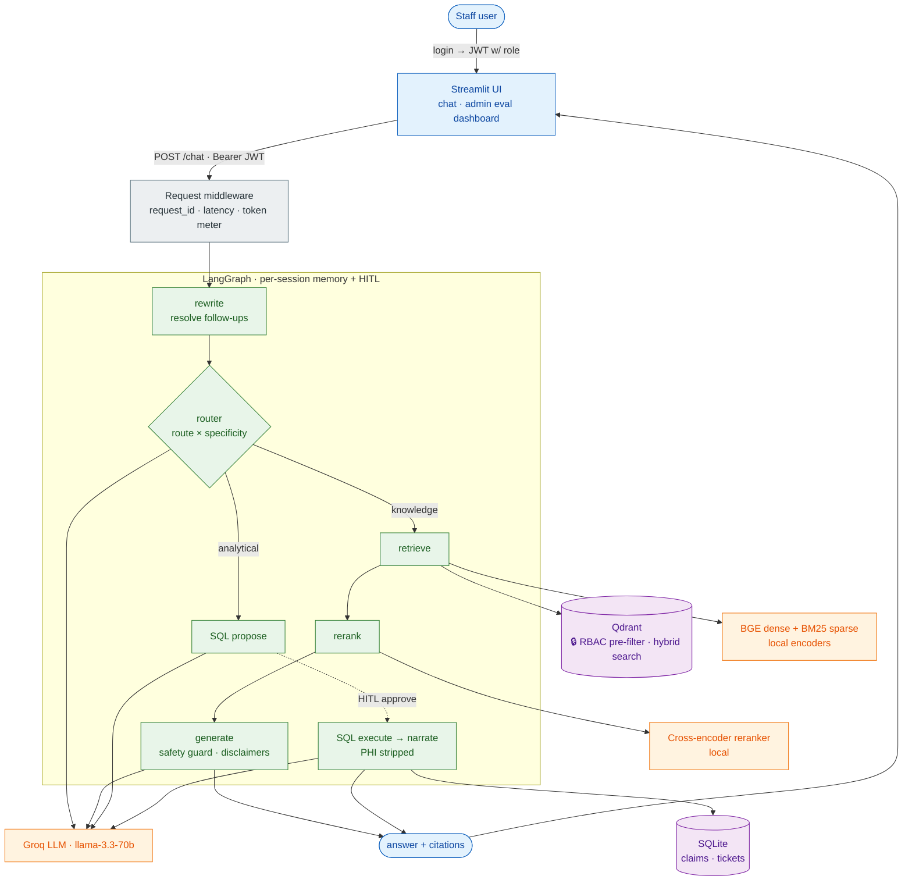
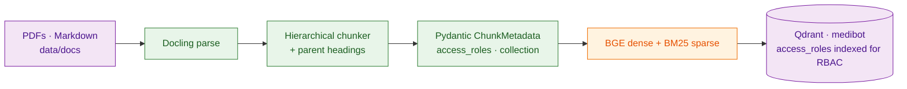

# MediBot — RBAC-Aware Clinical RAG Assistant

An internal AI assistant for **the Health Network** (a fictional 12-hospital group
in India). Staff ask natural-language questions and get **cited answers from the right
documents** — scoped to what their role is allowed to see, enforced at the vector-store
level. It combines **hybrid document RAG** and **text-to-SQL RAG** behind a LangGraph
pipeline, with a measurable eval harness and PHI-safe observability.

> **What this is:** a portfolio project built eval-first — every pipeline stage is
> instrumented and graded against ground truth, not just wired together.

---

## Highlights

- **Hybrid RAG** — dense (BGE) + sparse (BM25) retrieval fused in Qdrant, then a
  cross-encoder reranker. Answers are grounded in retrieved chunks with source citations.
- **RBAC as a pre-filter** — the role's collection allow-list is applied *inside* the
  Qdrant query. Restricted chunks are never returned to the application or the LLM — not
  post-filtered after the fact.
- **SQL RAG** — natural-language → SQL over the claims/maintenance database, gated to
  `billing_executive` and `admin`, with PHI columns stripped before narration.
- **LangGraph orchestration** — a router splits analytical vs knowledge queries;
  multi-turn memory (SqliteSaver checkpointer) and optional human-in-the-loop SQL
  approval (`interrupt()`) are native.
- **Deterministic medical safety** — disclaimers appended in code (not left to the LLM),
  and a guard that blocks unit conversions and prescriptive/advice-giving language.
- **Eval harness** — 9 tracks (RBAC red-team, retrieval A/B, SQL correctness, routing,
  numeric faithfulness, chunk quality, safety, judge calibration) with an admin dashboard.
- **PHI-safe observability** — structured JSON logs correlated by `request_id`
  (`X-Request-ID` header), per-stage latency, and per-request LLM token/cost accounting
  (`X-LLM-Tokens` header). Never logs query or answer text.

### Portfolio upgrades (beyond the base assignment)

- **HyDE** — optionally embeds a hypothetical answer for the dense path to bridge the
  query↔document vocabulary gap (`HYDE_ENABLED`).
- **Two-axis router** — classifies both *route* (SQL vs hybrid) and *specificity*
  (point-lookup / aggregate / exploratory), which tunes reranking depth.
- **Deterministic denial verbalizer** — RBAC refusals are templated (zero LLM cost,
  auditable, no hallucination), replacing an LLM-generated refusal.

---

## Architecture

**Query pipeline (per request):**



**Ingestion (offline, run once):**



- **Ingestion (offline):** Docling parses PDFs/MD → HierarchicalChunker → Pydantic-
  validated `ChunkMetadata` → dense + sparse embeddings → Qdrant (one `medibot` collection,
  `access_roles` indexed for the RBAC pre-filter).
- **Query (per request):** router → hybrid retrieval (RBAC pre-filter) → cross-encoder
  rerank → grounded generation with deterministic disclaimers; **or** the SQL path.
- **Three-layer rule:** graph nodes → services → adapters. Each layer only calls the next;
  vendor SDKs live only in adapters.

See [`docs/ARCHITECTURE.md`](docs/ARCHITECTURE.md) for the full pipeline, model inventory,
and Pydantic boundaries.

---

## Tech stack

| Concern | Choice |
|---|---|
| PDF parsing / chunking | Docling + HierarchicalChunker |
| Dense embedding | `BAAI/bge-small-en-v1.5` (local, CPU) |
| Sparse embedding | FastEmbed / Qdrant BM25 (local) |
| Vector store | Qdrant (hybrid search + metadata filter) |
| Reranker | `cross-encoder/ms-marco-MiniLM-L-6-v2` (local) |
| LLM | Groq (`llama-3.3-70b-versatile`) |
| Orchestration | LangGraph (StateGraph, SqliteSaver, `interrupt()`) |
| Backend | FastAPI + Pydantic, JWT auth |
| Frontend | Streamlit (chat tab + admin eval dashboard) |
| Evals | pytest + numpy (deterministic) · DeepEval (LLM-judge) |
| Lint / types | ruff · mypy |

---

## Repository layout

```
backend/
  src/          FastAPI app (imported as `from src...`) — api, graph, services, adapters, models, config
  ingestion/    ingest.py, ensure_ingested.py (compose entrypoint), run_evals.py, data/ (docs + SQLite DB)
  evals/        golden sets, test_*.py (9 tracks), results/
frontend/       Streamlit app (chat + eval dashboard)
docs/           ARCHITECTURE, EVAL_PLAN, PROMPTS, GUARDRAILS, DATA_DICTIONARY, DEPLOY, EXTENSIONS, …
docker-compose.yml · Dockerfile.backend · Dockerfile.frontend · pytest.ini
```

All importable backend code lives under `backend/`, so `PYTHONPATH=backend` is the only
path entry needed (`pytest.ini` sets this for tests).

---

## Quick start (Docker — recommended)

**Prerequisites:** Docker, and a free [Groq API key](https://console.groq.com).

```bash
# 1. Configure env
cp .env.example .env
#    edit .env:  GROQ_API_KEY=your_key   (QDRANT_PORT=6335 already set for compose)

# 2. Build + start. First run ingests the corpus (downloads embedding models,
#    a few minutes), then the backend + frontend come up with a populated index.
docker compose up -d --build

# 3. Open the app
open http://localhost:8700
```

Startup ordering is automatic (no race): `qdrant → ingest (populate, then exit) →
backend (waits for ingest to complete, then healthcheck) → frontend`.

| Service | URL |
|---|---|
| Frontend (Streamlit) | http://localhost:8700 |
| Backend (FastAPI) | http://localhost:8001 · docs at `/docs` |
| Qdrant dashboard | http://localhost:6335/dashboard |

```bash
docker compose logs -f backend      # follow backend logs
docker compose logs ingest          # ingestion progress / "skip (already populated)"
docker compose down                 # stop
```

---

## Demo accounts & RBAC matrix

One-click login buttons are on the sign-in page (passwords never rendered).

| Role | Username | Password | Document collections | SQL RAG |
|---|---|---|---|---|
| Doctor | `dr.mehta` | `doctor123` | clinical, nursing, general | ✗ |
| Nurse | `nurse.priya` | `nurse123` | nursing, general | ✗ |
| Billing | `billing.ravi` | `billing123` | billing, general | ✓ |
| Technician | `tech.anand` | `tech123` | equipment, general | ✗ |
| Admin | `admin.sys` | `admin123` | **all** | ✓ |

**Try it:**
- As **Doctor**: *"first-line drug for Type 2 Diabetes?"* → cited clinical answer.
- As **Nurse**: *"show me all insurance billing codes"* → RBAC refusal (no billing access).
- As **Billing**: *"how many claims are escalated?"* → SQL RAG answer (`8`).
- RBAC red-team: the same NSTEMI query returns *billing* data to Billing and *clinical*
  protocol to Doctor — never crossing collections.

---

## Local dev (venv, no Docker for the app)

```bash
python -m venv .venv && source .venv/bin/activate
pip install -r requirements.txt -r requirements-dev.txt

docker compose up -d qdrant                    # Qdrant only (host 6335)

# ingest once, then run backend + frontend
PYTHONPATH=backend python backend/ingestion/ingest.py
PYTHONPATH=backend uvicorn src.api.app:app --reload --port 8000
MEDIBOT_API_URL=http://localhost:8000 streamlit run frontend/app.py --server.port 8700
```

---

## Evaluations

The eval harness is the point of the project. Tracks are **run on demand from the admin
Evaluation tab** (`POST /evals/run`), or headless:

```bash
# all tracks (needs Groq for judge tracks) — writes JUnit XML + logs to backend/evals/results/
pytest backend/evals/ -v

# deterministic-only (no Groq tokens), RBAC first / fail-fast
pytest backend/evals/test_rbac.py -x && \
  pytest backend/evals/test_safety.py backend/evals/test_chunk_quality.py
```

Tracks: RBAC red-team (zero-leak, fail-closed), retrieval A/B (P@3/MRR), SQL correctness,
routing accuracy, numeric faithfulness, chunk quality, medical safety, judge calibration.
Thresholds live in `backend/evals/eval_config.py`. See [`docs/EVAL_PLAN.md`](docs/EVAL_PLAN.md).

> **Note:** Groq's free tier has per-minute and per-day token caps; the LLM-judge tracks
> (faithfulness, calibration) can hit them. Run the deterministic tracks freely; pace the
> judge tracks. Rate-limit errors surface as a clean "try again in X" message.

---

## Observability

PHI-safe by design — only IDs, counts, scores, and durations are ever logged.

- **Correlation:** every request gets a `request_id`, threaded through all stages and
  returned as the `X-Request-ID` response header (propagated if the client sends one).
- **Latency:** `latency_ms` per stage (router, retrieval, rerank, generation, SQL) plus a
  total `duration_ms` on the `http_request` event.
- **Cost:** per-request Groq token spend in the `X-LLM-Tokens` header and logs.

Visual tracing (Arize Phoenix) is planned — see Roadmap.

---

## Roadmap

Planned extensions (design in [`docs/EXTENSIONS.md`](docs/EXTENSIONS.md)):

- **Agentic SQL tool-loop** — replace the linear SQL path with a ReAct sub-graph
  (multi-step queries, self-correction). *(Phase 12)*
- **Distributed tracing with Arize Phoenix** — per-request span waterfalls + latency/cost
  dashboards on top of the existing PHI-safe logs. *(Phase 12)*
- **Extension eval tracks** — dedicated multi-turn-rewrite and HITL-SQL-safety tracks.

---

## Safety & data notes

- MediBot **retrieves, it does not advise** — it quotes protocols with citations and never
  prescribes, diagnoses, or interprets patient data. Clinical answers carry a mandatory,
  deterministic disclaimer.
- All patient data is **synthetic** (`backend/ingestion/data/mediassist.db`). Query text
  and LLM responses are never logged or persisted.
- Demo credentials and the default JWT secret are for local/demo only — the backend
  refuses to start with the default secret outside a `dev` environment.
