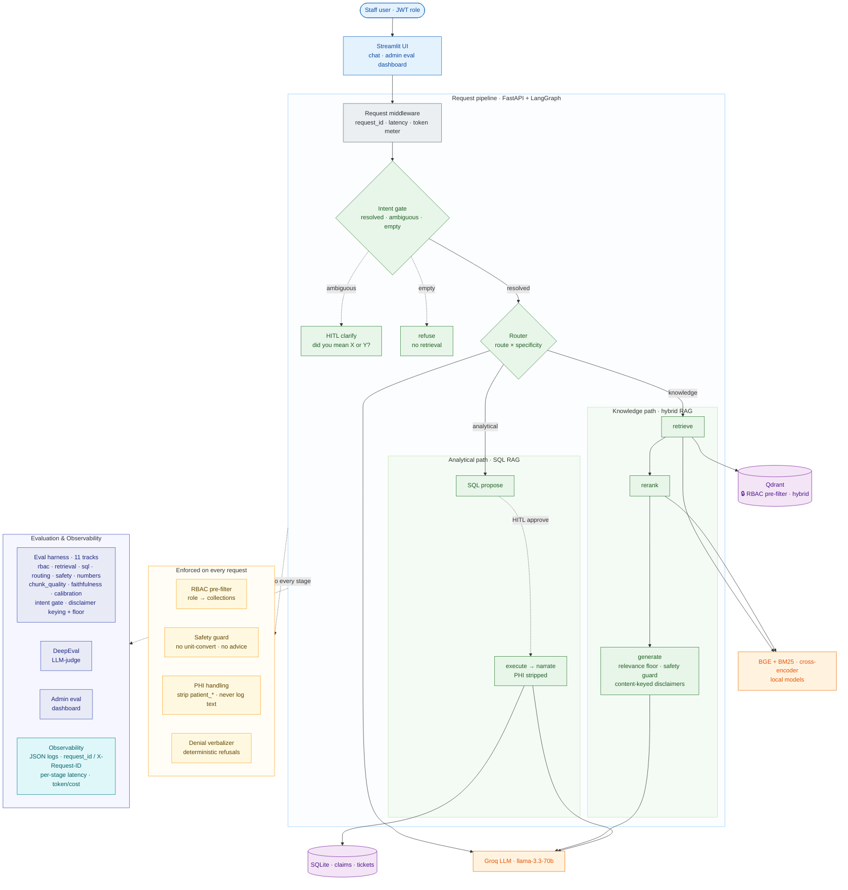
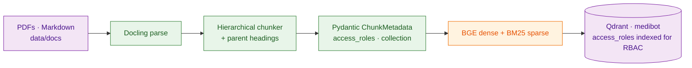

# Medi-Bot-AI — RBAC-Aware Clinical RAG Assistant

Medibot-AI is an internal AI assistant.Staff ask natural-language questions and get **cited answers from the right
documents** — scoped to what their role is allowed to see.

---

## Highlights

| Capability | What it does |
|---|---|
| **Hybrid RAG** | Dense (BGE) + sparse (BM25) retrieval fused in Qdrant, then a cross-encoder reranker. Answers are grounded in retrieved chunks with source citations. |
| **RBAC as a pre-filter** | The role's collection allow-list is applied *inside* the Qdrant query — restricted chunks are never returned to the app or the LLM, not post-filtered after the fact. |
| **SQL RAG** | Natural-language → SQL over the claims/maintenance database, gated to `billing_executive` and `admin`, with PHI columns stripped before narration. |
| **Intent gate (admission control)** | Before any retrieval, a gate classifies each turn as *resolved* (answer it), *ambiguous* (ask which prior topic — HITL clarify), or *empty* (refuse; never retrieve). Stops contentless/keyword-collision inputs from producing confident wrong answers. |
| **LangGraph orchestration** | Intent gate → router (analytical vs knowledge) → path; multi-turn memory (SqliteSaver) and human-in-the-loop `interrupt()` for both SQL approval **and** ambiguity clarification are native. |
| **Deterministic medical safety** | Disclaimers appended in code (not the LLM) and *content-keyed* (only when clinical/nursing is central), a relevance floor that drops low-score noise before generation, plus a guard blocking unit conversions and prescriptive language. |
| **Persistent chat management** | Per-user chat history survives logout (sidebar shows the 5 most recent; the DB keeps all), 5-turn cap per chat, New Chat, and delete (purges both the session index and the checkpointer content). |
| **Eval harness** | 11 built tracks (RBAC red-team, retrieval A/B, SQL correctness, routing, numeric faithfulness, chunk quality, safety, judge calibration, **intent gate**, **disclaimer keying + relevance floor**) with an admin dashboard. |
| **PHI-safe observability** | Structured JSON logs correlated by `request_id` (`X-Request-ID` header), per-stage latency, and per-request LLM token/cost accounting (`X-LLM-Tokens`). Never logs query or answer text. |

---

## Architecture



**Ingestion (offline, run once):**


**Repository Layout**


- **Ingestion (offline):** Docling parses PDFs/MD → HierarchicalChunker → Pydantic-
  validated `ChunkMetadata` → dense + sparse embeddings → Qdrant (one `medibot` collection,
  `access_roles` indexed for the RBAC pre-filter).
- **Query (per request):** intent gate (admission control — resolve / clarify / refuse) →
  router → hybrid retrieval (RBAC pre-filter) → cross-encoder rerank → relevance floor →
  grounded generation with content-keyed disclaimers; **or** the SQL path.
- **Three-layer rule:** graph nodes → services → adapters. Each layer only calls the next;
  vendor SDKs live only in adapters.

See [`docs/ARCHITECTURE.md`](docs/ARCHITECTURE.md) for the full pipeline, model inventory,
and Pydantic boundaries.

---

## Tech stack

| Concern | Choice |
|---|---|
| PDF parsing / chunking | Docling + HierarchicalChunker |
| Dense embedding | `BAAI/bge-small-en-v1.5` (local, CPU) |
| Sparse embedding | FastEmbed / Qdrant BM25 (local) |
| Vector store | Qdrant (hybrid search + metadata filter) |
| Reranker | `cross-encoder/ms-marco-MiniLM-L-6-v2` (local) |
| LLM | Groq (`llama-3.3-70b-versatile`) |
| Orchestration | LangGraph (StateGraph, SqliteSaver, `interrupt()`) |
| Backend | FastAPI + Pydantic, JWT auth |
| Frontend | Streamlit (chat tab + admin eval dashboard) |
| Evals | pytest + numpy (deterministic) · DeepEval (LLM-judge) |
| Lint / types | ruff · mypy |

---

## Quick start (Docker — recommended)

**Prerequisites:** Docker, and a free [Groq API key](https://console.groq.com).

```bash
# 1. Configure env
cp .env.example .env

# edit .env:  GROQ_API_KEY=your_key   (QDRANT_PORT=6335 already set for compose)

# 2. Build + start. First run ingests the corpus (downloads embedding models, a few minutes), then the backend + frontend come up with a populated index.
docker compose up -d --build

# 3. Open the app
open http://localhost:8700
```

Startup ordering is automatic (no race): `qdrant → ingest (populate, then exit) →
backend (waits for ingest to complete, then healthcheck) → frontend`.

| Service | URL |
|---|---|
| Frontend (Streamlit) | http://localhost:8700 |
| Backend (FastAPI) | http://localhost:8001 · docs at `/docs` |
| Qdrant dashboard | http://localhost:6335/dashboard |

```bash
docker compose logs -f backend      # follow backend logs

docker compose logs ingest          # ingestion progress / "skip (already populated)"

docker compose down                 # stop
```

---

## Demo accounts & RBAC matrix

One-click login buttons are on the sign-in page (passwords never rendered).

| Role | Username | Document collections | SQL RAG |
|---|---|---|---|
| Doctor | `dr.mehta` | clinical, nursing, general | ✗ |
| Nurse | `nurse.priya` | nursing, general | ✗ |
| Billing | `billing.ravi` | billing, general | ✓ |
| Technician | `tech.anand` | equipment, general | ✗ |
| Admin | `admin.sys` | **all** | ✓ |

**Try it:**
- As **Doctor**: *"first-line drug for Type 2 Diabetes?"* → cited clinical answer.
  
  
- As **Billing**: *"how many claims are escalated?"* → SQL RAG answer (`8`).
  

- RBAC red-team: the same NSTEMI query returns *billing* data to Billing and *clinical*
  protocol to Doctor — never crossing collections.

---

## Local dev (venv, no Docker for the app)

```bash
python -m venv .venv && source .venv/bin/activate

pip install -r requirements.txt -r requirements-dev.txt

docker compose up -d qdrant  #Qdrant only (host 6335)

# ingest once, then run backend + frontend
PYTHONPATH=backend python backend/ingestion/ingest.py

PYTHONPATH=backend uvicorn src.api.app:app --reload --port 8000

MEDIBOT_API_URL=http://localhost:8000 streamlit run frontend/app.py --server.port 8700
```

---

## Evaluations

The eval harness is the point of the project. Tracks are **run on demand from the admin
Evaluation tab** (`POST /evals/run`), or headless:

```bash
# all tracks (needs Groq for judge tracks) — writes JUnit XML + logs to backend/evals/results/

pytest backend/evals/ -v

# deterministic-only (no Groq tokens), RBAC first / fail-fast

pytest backend/evals/test_rbac.py -x && \
  pytest backend/evals/test_safety.py backend/evals/test_chunk_quality.py
```

`Tracks`: 
- RBAC red-team (zero-leak, fail-closed), 
- retrieval A/B (P@3/MRR), 
- SQL correctness,
- routing accuracy, 
- numeric faithfulness, 
- chunk quality, 
- medical safety, 
- judge calibration,
- intent gate (multi-turn admission control — resolved/ambiguous/empty), 
- disclaimer keying + relevance floor (deterministic, no LLM).

Thresholds live in `backend/evals/eval_config.py`. See [`docs/EVAL_PLAN.md`](docs/EVAL_PLAN.md).

> **Note:** Groq's free tier has per-minute and per-day token caps; the LLM-judge tracks
> (faithfulness, calibration) can hit them. Run the deterministic tracks freely; pace the
> judge tracks. Rate-limit errors surface as a clean "try again in X" message.

---

## Observability

PHI-safe by design — only IDs, counts, scores, and durations are ever logged.

- **Correlation:** every request gets a `request_id`, threaded through all stages and
  returned as the `X-Request-ID` response header (propagated if the client sends one).
- **Latency:** `latency_ms` per stage (router, retrieval, rerank, generation, SQL) plus a
  total `duration_ms` on the `http_request` event.
- **Cost:** per-request Groq token spend in the `X-LLM-Tokens` header and logs.

Visual tracing (Arize Phoenix) is planned — see Roadmap.

---

## Roadmap

- **Agentic SQL tool-loop** — replace the linear SQL path with a ReAct sub-graph
  (multi-step queries, self-correction). *(Phase 12)*
- **Distributed tracing with Arize Phoenix** — per-request span waterfalls + latency/cost
  dashboards on top of the existing PHI-safe logs. *(Phase 12)*
- **Extension eval tracks** — intent-gate and disclaimer-keying tracks are **built**;
  dedicated multi-turn-retrieval-lift and HITL-SQL-token-lifecycle tracks are next.

